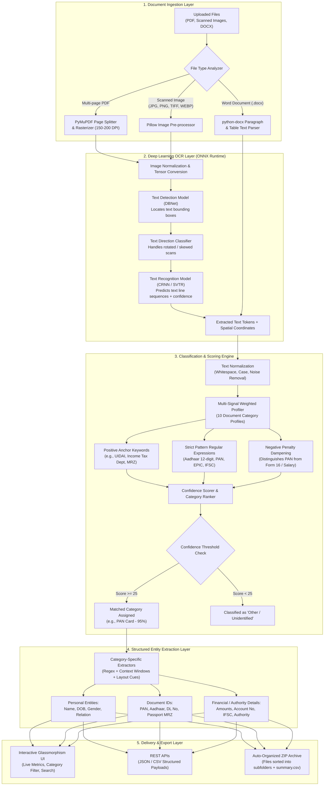

# 🪪 DocuID Pro — AI Identity Document Identification & Intelligence Suite

[](https://www.python.org/)
[](https://fastapi.tiangolo.com/)
[](https://onnxruntime.ai/)
[](https://github.com/RapidAI/RapidOCR)
[](LICENSE)

An intelligent, production-ready, zero-external-dependency AI system that ingests, classifies, extracts structured data from, and automatically organizes Indian and international identity documents (PDFs, Images, and Word DOCX).

---

## 🔄 How It Works (System Architecture & Pipeline)

The diagram below illustrates the end-to-end processing pipeline, from raw file upload to structured extraction and automated zip sorting:



---

## 💡 Why This Project is Useful

Manual verification and handling of identity and financial documents is a major operational bottleneck across industries.

### Real-World Business Problems Solved:
1. **Elimination of Tedious Manual KYC**:
   - Banking, Fintech, and Insurance onboarding traditionally requires human operators to open each scan, check the document type, and manually transcribe names, dates, and ID numbers.
   - **DocuID Pro** turns hours of manual sorting and typing into seconds of automated, error-free processing.
2. **Multi-Page Batch Processing**:
   - Customers frequently submit a single 15-page PDF containing mixed documents (e.g., Aadhaar, PAN card, salary slips, and electricity bills). 
   - This application automatically tears the PDF apart into individual pages, classifies each page independently, and sorts them into dedicated folders.
3. **100% Privacy & Zero Cloud Dependency**:
   - Many OCR solutions require uploading confidential identity proofs to third-party public cloud APIs (e.g., Google Vision, AWS Textract).
   - This project runs **100% locally on CPU via ONNX Runtime**. No sensitive personal identifiable information (PII) ever leaves the user's computer or private server.
4. **Zero-Setup Portability**:
   - Traditional open-source OCR pipelines force users to install external system binaries like `tesseract.exe` and `poppler-utils`, and configure Windows environment variables.
   - **DocuID Pro** uses self-contained ONNX deep learning models and native PyMuPDF binaries, running straight out of the box with zero external software installations.

---

## 🤖 How Machine Learning Works in This Project

The system combines **Deep Learning Computer Vision** with **Knowledge-Driven Natural Language Heuristics**:

### 1. Deep Learning OCR via ONNX Runtime
Instead of traditional legacy OCR engines that rely on static pixel thresholds and template matching, the OCR engine uses modern deep neural networks packaged in lightweight ONNX format:
- **DBNet (Differentiable Binarization Neural Network)**: 
  - A real-time convolutional neural network that detects text bounding boxes at arbitrary angles, uneven lighting, folds, and low resolutions.
- **Direction & Orientation Classifier**: 
  - An angle-detection classifier that automatically identifies if a document or text block is upside-down or rotated (0°, 90°, 180°, 270°) and rectifies it before character recognition.
- **CRNN / SVTR (Convolutional Recurrent Neural Network / Single Vision Transformer)**:
  - Takes the cropped, rectified text feature maps and decodes character sequences using Connectionist Temporal Classification (CTC), outputting high-precision text with character-level confidence scores.

### 2. Multi-Signal Weighted Classification Engine
Unlike naive keyword searches or black-box classifiers that make unexplainable guesses, our classification engine uses an explainable, multi-signal scoring model:
- **Positive Semantic Weights**: Key institutional indicators (e.g., `Unique Identification Authority of India` +45, `Income Tax Department` +45, `Election Commission` +50).
- **Formal Regex Discriminators**: Validates standardized national identification syntax:
  - **Aadhaar**: Verflow 12-digit format `[2-9]{1}[0-9]{3}\s+[0-9]{4}\s+[0-9]{4}`
  - **PAN**: Strict 10-character alphanumeric structure `[A-Z]{5}[0-9]{4}[A-Z]{1}`
  - **Driving License**: State-code prefixed format `[A-Z]{2}[0-9]{2}[0-9A-Z\s]{11,15}`
  - **Passport**: Machine Readable Zone (MRZ) checksum format `P<IND...`
- **Negative Penalty Dampening**: 
  - Prevents false-positive collisions. For example, a Form 16 or Salary Slip often contains an employee's PAN card number; negative keyword rules (`form 16`, `salary slip`, `deductions`) penalize the PAN score to ensure multi-page financial documents aren't misclassified as standalone ID cards.

### 3. Spatial & Contextual Entity Extraction
Once classified, document-specific extractors inspect the text stream and bounding-box geometry:
- Contextual search windows locate key fields (e.g., locating "DOB" or "Date of Birth" and extracting following date strings formatted as `DD/MM/YYYY`).
- Proximity-based name isolation extracts primary person names while filtering out issuing authority names (e.g., distinguishing the citizen's name from "Government of India").

---

## 🔮 How It Can Be Useful in the Future (Roadmap & Evolution)

| Area | Planned Capabilities |
| :--- | :--- |
| **Multimodal Vision-Language Models** | Integrating fine-tuned **LayoutLMv3** or **Donut** transformer models to natively process complex document visual structures, complex financial tables, and signatures in a single forward pass. |
| **Tampering & Anti-Fraud Detection** | Adding forensic computer vision models to detect copy-paste pixel anomalies, manipulated fonts, fake stamps, and fraudulent holograms on forged identity cards. |
| **Automated PII Masking** | Automated redaction / blurring of the first 8 digits of Aadhaar numbers and sensitive biometric QR codes on the fly to guarantee UIDAI compliance before storage. |
| **Live Verification APIs** | Direct plug-ins for government verification networks: verifying extracted details in real time against DigiLocker, NSDL (PAN verification), and VAHAN (Driving License registry). |
| **Regional Language OCR** | Expanding the ONNX recognition dictionary to support multilingual Indian scripts (Hindi, Bengali, Tamil, Telugu, Marathi, Gujarati, Kannada). |
| **Edge & Mobile Deployment** | Compiling the ONNX engine into WebAssembly (Wasm) or Flutter/React Native plugins to run entirely inside client browsers and mobile apps with offline capability. |

---

## 🛠️ Technologies & Tools Used

### Backend & Core Processing
| Technology | Role |
| :--- | :--- |
| **Python 3.9 - 3.12** | Core programming language |
| **FastAPI** | High-performance asynchronous REST API framework |
| **Uvicorn** | Lightning-fast ASGI web server |
| **PyMuPDF (`fitz`)** | Blazing-fast PDF page splitting, vector text extraction, and high-DPI rasterization |
| **RapidOCR (ONNX Runtime)** | Deep Learning OCR engine executing DBNet & CRNN models locally on CPU |
| **Pillow (`PIL`)** | Image preprocessing, format conversion, and thumbnail generation |
| **python-docx** | Native parsing of Microsoft Word `.docx` documents and tables |
| **python-multipart** | Handling streaming multi-file multipart form uploads |

### Frontend & User Interface
| Technology | Role |
| :--- | :--- |
| **HTML5 & Vanilla JavaScript (ES6+)** | Lightweight, reactive single-page client without heavy node_modules build steps |
| **Tailwind CSS** | Modern glassmorphism UI design with dark mode styling |
| **Lucide Icons** | Clean vector iconography across all document categories and actions |

---

## 🎯 10 Supported Document Categories

1. **Aadhaar Card** *(UIDAI, Enrollment No, 12-digit Aadhaar pattern)*
2. **PAN Card** *(Income Tax Department, Permanent Account Number pattern)*
3. **Driving License** *(Motor Driving Licence, Transport Department, DL No)*
4. **Voter ID Card** *(Election Commission of India, EPIC Card Number)*
5. **Passport** *(Republic of India, MRZ Code parsing)*
6. **Salary Slip / Payslip** *(Earnings, Net Pay, Deductions, Pay Period)*
7. **Form 16** *(TDS Certificate under Section 203, TRACES, Assessment Year)*
8. **Bank Statement** *(Account Holder, Statement Period, Ledger, Balances)*
9. **Bank Cheque** *(Payee Name, IFSC Code, Account Payee, Cheque Amount)*
10. **Utility Bill** *(Electricity, Water Authority, Consumer ID, Due Dates)*

---

## 🚀 Quick Start Guide

### Option 1: 1-Click Desktop Launcher (Windows)
Simply double-click the included batch launcher:
```cmd
run_app.bat
```
This automatically starts the server and opens `http://127.0.0.1:8000` in your default browser.

---

### Option 2: Standard Python / Pip
1. **Clone the repository**:
   ```bash
   git clone https://github.com/Jeetdas2004/Documents-Identification.git
   cd Documents-Identification
   ```
2. **Install dependencies**:
   ```bash
   pip install -r requirements.txt
   ```
3. **Run the server**:
   ```bash
   python run.py
   ```
4. Open **`http://127.0.0.1:8000`** in your browser.

---

### Option 3: Blazing Fast with UV
```bash
uv run --with fastapi --with uvicorn --with pymupdf --with rapidocr-onnxruntime --with python-docx --with python-multipart --with pillow python run.py
```

---

## 📂 Project Structure

```
Documents-Identification/
│
├── run_app.bat               # 1-click Windows desktop launcher
├── run.py                    # Server launcher with automatic browser opening
├── app.py                    # FastAPI server & REST API endpoints
├── requirements.txt          # Python dependencies
├── documents.pdf             # 10-page sample identity document dataset
├── README.md                 # Complete documentation & system guide
│
├── engine/                   # Core Processing Engine
│   ├── __init__.py
│   ├── ocr.py                # PyMuPDF rendering & ONNX Deep OCR engine
│   ├── classifier.py         # Multi-signal weighted classification logic
│   └── extractor.py          # Category-specific structured entity extractors
│
├── static/                   # Modern Web Application Frontend
│   └── index.html            # Tailwind CSS + Lucide Icons interactive UI
│
├── Classify.ipynb            # (Legacy) Original Google Colab notebook
├── Extract.ipynb             # (Legacy) Original Google Colab notebook
└── main.ipynb                # (Legacy) Original Google Colab notebook
```

---

## 🔌 API Reference

| Method | Endpoint | Description |
| :--- | :--- | :--- |
| `GET` | `/` | Serves the interactive Web Application |
| `POST` | `/api/upload` | Upload one or multiple documents (`.pdf`, `.jpg`, `.png`, `.docx`) |
| `POST` | `/api/sample` | 1-Click execution on the included `documents.pdf` dataset |
| `GET` | `/api/preview/{item_id}` | Returns high-resolution rendered preview image of any document page |
| `GET` | `/api/stats` | Summary statistics (total items, identified counts, accuracy) |
| `GET` | `/api/download-zip` | Download categorized ZIP archive sorted into category folders |
| `GET` | `/api/export-csv` | Export all extracted fields as a CSV spreadsheet |
| `GET` | `/api/export-json` | Full structured JSON export of all items |
| `POST` | `/api/clear` | Clear the current working session |

---

## 📜 License

Distributed under the MIT License. Feel free to use, modify, and distribute for educational, research, and commercial projects.
